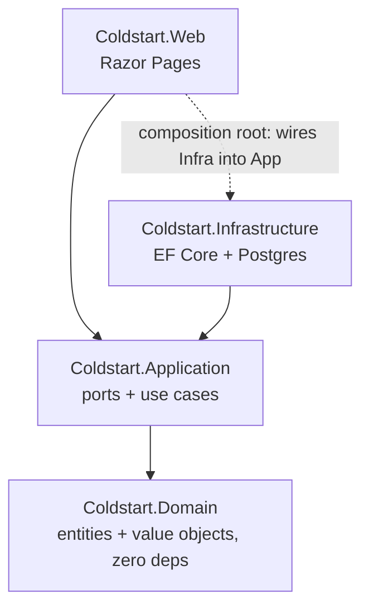

# Coldstart .NET SaaS — SP1: Solution Skeleton, Domain & Persistence

**Date:** 2026-07-02
**Status:** Proposed
**Author:** Andrzej Lech (with Claude)

## Context

Coldstart is today a working Python lead engine (harvest → score → enrich → find/verify
emails → per-customer drafts). We are turning it into a multi-customer SaaS and, in the
process, porting the backend to **.NET 10** with **Razor Pages** as the UI, following the
hexagonal / DDD standards in the global engineering guide (CS-HEX, CS-DDD, CS-DATA, CS-MOD).

The port is **incremental**: the Python engine keeps running as the reference and the live
lead source until the .NET side reaches parity, then Python is removed.

### Full roadmap (each is its own spec → plan → build)

| # | Sub-project | Delivers |
|---|-------------|----------|
| **SP1** | **Solution skeleton + domain + persistence** *(this spec)* | Hexagonal .NET 10 solution, core domain, EF Core + Postgres, a Razor page listing seeded leads |
| SP2 | Harvest + score + dedup + enrichment | Port of the Python engine core (HN/funding sources, scoring, Groq drafts) |
| SP3 | Email find + verify | Domain resolution → candidate generation → SMTP verify (MailKit), confidence stored |
| SP4 | Per-customer branding/templates | Config-driven draft rendering (de-hardcode `render.py`) |
| SP5 | Auth + lead-inbox UI | Identity (email+password + Google, merge-by-email); Razor inbox: view/edit/approve |
| SP6 | Sending | Draft-first flows + optional Gmail-OAuth one-click send + contacted/dedup guard |
| SP7 | Background worker + deploy | Scheduled per-customer harvest (`BackgroundService`) + hosting |

**This spec covers SP1 only** — the walking skeleton every later sub-project plugs into.

### Product decisions already settled (context for later SPs, not built in SP1)

- **Auth:** email + password primary; Google OAuth optional; accounts merged by email
  (ASP.NET Core Identity). *(SP5)*
- **Gmail is never required to view drafts.** Draft-first is the default; connecting Gmail
  is an optional add-on for one-click send only — avoids the "give us your inbox" fear and
  the data-surface risk. *(SP6)*
- **UI is Razor Pages** (server-rendered) — no separate SPA.

## Goals (SP1)

1. A compiling, runnable .NET 10 solution with hexagonal project boundaries.
2. A core domain model (`Customer`, `Lead`) with behaviour, not anemic setters.
3. EF Core persistence on **Postgres** (local via Docker) behind Application ports.
4. **Proof of life:** a Razor page that lists seeded leads for a seeded customer, served
   through Web → Application → Infrastructure → Postgres.
5. Test project (xUnit + NSubstitute + FluentAssertions) covering domain invariants and the
   repository adapter.

## Non-goals (SP1 — explicitly later)

Authentication/Identity, harvesting sources, LLM enrichment, email find/verify, per-customer
branding, sending, background scheduling, deployment. No real customer data; seed only.

## Architecture

Four projects under `src/`, dependencies pointing inward only (CS-HEX-01/02):



- **Coldstart.Domain** — entities, value objects, domain logic. **Zero** external dependencies
  (no EF Core, no ASP.NET). (CS-HEX-01)
- **Coldstart.Application** — inbound ports (use-case interfaces) and outbound ports
  (`ILeadRepository`, `ICustomerRepository`); use-case implementations. Ports live here, not
  in Infrastructure. (CS-HEX-02) Repositories return `Task<IReadOnlyList<T>>` — no `IQueryable`
  crosses the boundary. (CS-DATA-01)
- **Coldstart.Infrastructure** — EF Core `DbContext`, entity configurations, repository adapters
  implementing the Application ports, migrations, seed. `internal` implementations where
  possible. (CS-MOD-01)
- **Coldstart.Web** — Razor Pages + the composition root (DI wiring lives here only; CS-HEX-03).

## Domain model (SP1 slice)

```
Customer (aggregate root)
  Id            : CustomerId (record, Guid-backed)
  Name          : string
  // niche/branding/sender config arrive in SP2/SP4
  leads         : private list, exposed read-only

Lead (aggregate root)
  Id              : LeadId (record)
  CustomerId      : CustomerId
  Company         : string
  Fit             : Fit (enum: Yes/Maybe/No)
  Subject         : string
  Draft           : string           // body only; branding rendered later (SP4)
  Status          : LeadStatus (enum: PendingReview/Approved/Rejected/Sent/Shelved)
  RecipientEmail  : EmailAddress?     // value object; null until found (SP3)
  EmailConfidence : EmailConfidence (enum: None/Inferred/CatchAll/Verified)
  CreatedAt       : DateTimeOffset

  Behaviour (no public setters — CS-DDD-02):
    Approve(EmailAddress recipient)  // guards: must have a recipient; not already Sent
    Reject()
    Shelve()
    MarkSent(DateTimeOffset when)    // guards: must be Approved with a recipient
```

- Value objects are `record` types (CS-DDD-01): `CustomerId`, `LeadId`, `EmailAddress`
  (validates `@`), `EmailConfidence`.
- Entities protect state with `private set`/`init` and internal constructors; created via
  factory methods (e.g. `Lead.Create(...)`). (CS-DDD-01)
- Status transitions are enforced by methods that throw `DomainException` on invalid moves —
  no raw status setter. (CS-DDD-02)

## Persistence

- **EF Core** targeting **Npgsql/Postgres**, run locally via Docker
  (`docker compose up` a `postgres:17` service). Connection string from configuration
  (`appsettings.Development.json` + user-secrets/env; never committed).
- `ColdstartDbContext` in Infrastructure; `IEntityTypeConfiguration<T>` per aggregate maps
  value objects (owned types / conversions for `EmailAddress`, enums as strings).
- `LeadRepository` / `CustomerRepository` implement the Application ports; async all the way
  with `CancellationToken` threaded through (CS-DATA-03).
- **Migrations** checked into Infrastructure. A `DbSeeder` inserts one demo customer
  (Coldstart, andrzej.lech.andrzej@gmail.com as the future recipient) and a handful of leads
  mirroring the shape of the real ones, so the Razor page has data on first run.

## Data flow (proof of life)

```
GET /leads
  → Leads Razor PageModel calls IListLeads use case (Application)
  → use case calls ILeadRepository.ForCustomer(customerId, ct) (port)
  → LeadRepository (Infrastructure) queries Postgres via EF Core, maps rows → Lead
  → page renders a table: Company · Fit · Status · RecipientEmail · Confidence
```

## Error handling

- Domain guards throw `DomainException` (a Domain-owned type) on invalid state transitions.
- Repository/DB failures surface as exceptions logged at the Web boundary; SP1 shows a simple
  error state on the page. Structured problem-details and resilience come with later SPs.
- No secrets in source or logs.

## Testing (SP1)

Framework: **xUnit + NSubstitute + FluentAssertions**. Naming
`Method_State_Expected`; strict AAA.

- **Domain (unit):** `Lead.Approve` sets recipient + status; `Approve` without a recipient
  throws; `MarkSent` on a non-approved lead throws; value-object validation
  (`EmailAddress` rejects a missing `@`). Instantiate domain objects directly — never mock
  them.
- **Repository (integration):** against a real Postgres via **Testcontainers.PostgreSql**
  (ephemeral container per run) — save a customer + leads, read them back, assert the mapping
  (incl. `EmailAddress` value object and enum conversions round-trip).
- Only outbound ports are mocked (none needed yet beyond the repository, which is tested for
  real).
- Minimum 1 happy path + 2 sad/edge paths per class.

## Repo layout & Python coexistence

```
/  (repo root)
  Coldstart.sln
  docker-compose.yml            # local Postgres
  src/
    Coldstart.Domain/
    Coldstart.Application/
    Coldstart.Infrastructure/
    Coldstart.Web/
  tests/
    Coldstart.Domain.Tests/
    Coldstart.Infrastructure.Tests/
  docs/superpowers/specs/       # this spec

  # --- Python (reference/live until parity, then deleted wholesale) ---
  leadengine/                   # engine + its tests moved under leadengine/tests/
  clients/  data/  scripts/  outreach/  site/
  requirements.txt  config.yaml  .venv/
```

- Python is untouched functionally and keeps running as reference. Its test files move to
  `leadengine/tests/` so root `tests/` is unambiguously .NET.
- The Python daily launchd harvest self-retires 2026-07-03; no ongoing Python scheduler after
  that. When .NET reaches parity (through SP2–SP7), removing Python = deleting the paths in the
  Python block above.

## Open questions / assumptions

- **.NET 10** assumed as the target framework (current LTS). Confirm SDK availability locally.
- Postgres major version pinned at 17 for dev; adjustable.
- No auth in SP1 means the `/leads` page is open locally — acceptable because there is no real
  data and no deployment yet.
