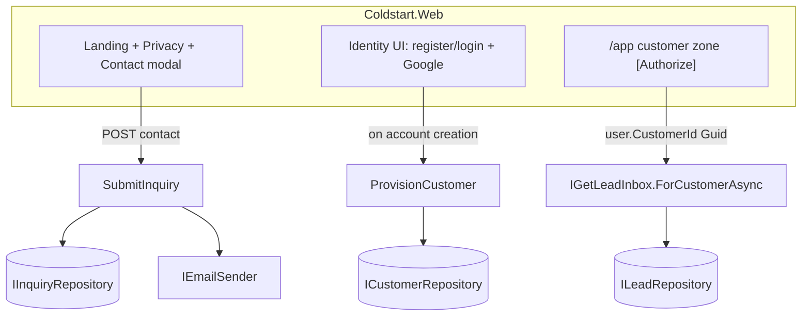

# Coldstart .NET — Frontend & Customer Zone (auth + mocked leads)

**Date:** 2026-07-03
**Status:** Proposed
**Author:** Andrzej Lech (with Claude)

## Context

Builds directly on SP1 (the .NET 10 hexagonal foundation: Domain `Customer`/`Lead`, Application ports + `ListLeads`/`GetLeadInbox`, EF Core + Postgres, Razor Web). SP1 currently lives on the unmerged `dotnet-port` branch; this stage continues there (both land together on merge) unless SP1 is merged to `main` first.

This stage delivers the **user-facing product shell**: the marketing site ported into Razor, a real contact-capture modal, working authentication, and a customer zone that lists **mocked leads**. It reprioritizes ahead of the harvest/enrich engine — the leads are seeded mock data until that pipeline (a later stage) fills them for real. The port source is the existing static `site/index.html` (721 lines, cream/ink brand, hero + 5 sections + statusbar + a client-side mailto composer) plus `favicon.svg`, `logo.svg`, `site.webmanifest`.

## Goals

1. Landing page ported into Razor, visually 1:1 with `site/index.html`.
2. A brand-matched **Privacy** page (starter draft, for the user's legal review).
3. A **server-side contact form** (the "send me an email" modal): stores an `Inquiry` in Postgres and emails a notification to the operator; `mailto` fallback retained.
4. **Working authentication** (ASP.NET Core Identity): email+password register/login/logout **and** Google OAuth with merge-by-email.
5. A **customer zone** (`/app`, authorized) that lists the logged-in customer's leads (seeded mock data) through the existing read path.
6. Shared design system so auth pages + zone match the brand.

## Non-goals (explicitly later)

Real harvesting/AI (leads stay mocked); billing/subscriptions; editing/sending leads from the zone (display only); password-reset & email-confirmation flows (login is not gated on confirmation this stage); admin views of captured inquiries (stored + emailed only).

## Architecture

All in `Coldstart.Web` (Razor Pages) over the existing hexagonal layers. New concerns placed by layer:

- **Domain:** `Inquiry` aggregate (contact submission). Reuses `EmailAddress`.
- **Application:** ports `IInquiryRepository`, `IEmailSender` (outbound); use cases `ISubmitInquiry` (store + notify), `IProvisionCustomer` (create Customer + seed mock leads), and an inbox read for a specific customer (`IGetLeadInbox.ForCustomerAsync(Guid customerId, …)` — primitive boundary so Web never holds a Domain `CustomerId`).
- **Infrastructure:** `InquiryRepository` (EF Core); `SmtpEmailSender` (MailKit, Gmail SMTP via app password); Identity — `ApplicationUser : IdentityUser` carrying a `Guid? CustomerId`, and `ColdstartDbContext` becomes `IdentityDbContext<ApplicationUser>` (Identity tables added to the same Postgres DB via a new migration).
- **Web (composition root + UI):** DI wiring for Identity + Google + Infrastructure + Application; public pages (landing `/`, privacy `/privacy`); Identity UI (register/login/logout, external-login); customer zone area `/app` with `[Authorize]`.

## Components

### 1. Design-system port
Extract `site/index.html`'s inline CSS into `wwwroot/css/site.css` and its modal JS into `wwwroot/js/contact.js`. Create a shared `Pages/Shared/_Layout.cshtml` carrying the brand (palette, fonts, statusbar, favicon/manifest/logo copied to `wwwroot`). Landing/privacy/auth/zone all use it. The SP1 demo `/Leads` page is superseded by the customer zone and removed.

### 2. Landing page (`Pages/Index.cshtml`)
Port the hero, the five `<section>`s, and the statusbar markup verbatim (static content). The two primary CTAs and the statusbar CTA open the contact modal (`data-compose`).

### 3. Privacy page (`Pages/Privacy.cshtml`)
Starter policy draft: what's collected (contact-form inquiries: name/email/niche/what-you-sell/message; account email; auth cookies), why, retention, contact route, data controller = Coldstart (Schiedam, NL) with KvK/VAT placeholders. Marked in-page as a draft pending the user's review. **Not legal advice.**

### 4. Contact capture
- **Modal** (ported markup + `contact.js`): fields `name, email, niche, whatYouSell, message?` + a hidden honeypot (`website`) that must stay empty. Live preview retained; `mailto:` link kept as a no-JS/failure fallback.
- **Handler** (`Pages/Index` POST or a dedicated `Pages/Contact` handler): server-side validation (required name/email, valid `EmailAddress`, honeypot empty); calls `ISubmitInquiry`.
- **`SubmitInquiry`**: persists an `Inquiry` via `IInquiryRepository`, then sends a notification through `IEmailSender` (from `adzius.lech@gmail.com` → `andrzej.lech.andrzej@gmail.com`, both configurable). Email failure is logged but does not fail the request (the inquiry is already stored) — returns success to the visitor.
- **`Inquiry` (Domain):** `Id (InquiryId)`, `Name`, `Email (EmailAddress)`, `Niche`, `WhatYouSell`, `Message?`, `CreatedAt`. Factory `Inquiry.Create(...)`; validates required fields.

### 5. Email sender
`IEmailSender { Task SendAsync(string to, string subject, string body, CancellationToken ct); }` (Application port). `SmtpEmailSender` (Infrastructure, MailKit) reads `Smtp` options (host `smtp.gmail.com`, port 465, username, app-password-from-config, from-name) from configuration/user-secrets/env. Registered in `AddInfrastructure`. Tests use a fake/recording `IEmailSender`.

### 6. Authentication (Identity + Google)
- `ApplicationUser : IdentityUser { Guid? CustomerId }`. `ColdstartDbContext : IdentityDbContext<ApplicationUser>`; new EF migration adds Identity + `Inquiry` tables. Existing `Customer`/`Lead` mappings unchanged.
- `Program.cs`: `AddIdentity<ApplicationUser, IdentityRole>()` with EF stores, `Password`/`SignIn` options (`RequireConfirmedAccount = false`), cookie auth, and `.AddGoogle(...)` reading `Authentication:Google:ClientId/ClientSecret` from user-secrets. If Google keys are absent, the Google button is hidden and email+password still works.
- **Register/Login/Logout**: custom Razor pages (or scaffolded Identity) styled with the shared layout.
- **Google merge-by-email**: on external-login callback, if a local user with the same email exists, link the Google login to it (`UserManager.AddLoginAsync`); otherwise create the user. Both paths run provisioning (below).

### 7. Tenancy, provisioning & the customer zone
- **`IProvisionCustomer`**: given a new `ApplicationUser`, creates a `Customer` (named from the user's email/display name), seeds N mock leads (via `Customer.AddLead(...)` — realistic sample companies/subjects), persists, and sets `user.CustomerId`. Idempotent (no-op if `CustomerId` already set). Invoked after successful local registration and after first external-login account creation.
- **Customer zone** (`Areas/App` or `/app`, `[Authorize]`): reads `CustomerId` from the signed-in user and calls `IGetLeadInbox.ForCustomerAsync(customerId, ct)` → renders the leads table (Company · Fit · Status · Recipient · Confidence) using the `LeadInbox`/`LeadSummary` read models. No Domain types in the page.

## Data model changes
- New `Inquiry` aggregate + `inquiries` table (EF config: `EmailAddress` conversion, timestamps).
- `ApplicationUser` (Identity) with `CustomerId Guid?` column.
- Identity tables (`AspNetUsers`, roles, logins, etc.) via `IdentityDbContext`.
- One new migration covering Identity + `Inquiry` + the `CustomerId` column.

## Error handling
- Contact form: field validation errors re-render the modal with messages; honeypot hit silently succeeds (no store, no email) to not tip off bots; email-send failure is swallowed+logged (inquiry persisted).
- Auth: standard Identity error surfacing (invalid credentials, duplicate email); external-login failures return to login with a message.
- Zone: a user with no `CustomerId` (edge) is provisioned lazily or shown an empty state.

## Testing
Framework per standards (xUnit + NSubstitute + FluentAssertions 7.*; strict AAA; Testcontainers Postgres; build 0 warnings).
- **Unit:** `Inquiry.Create` (happy + 2 sad: missing name, invalid email); `SubmitInquiry` (stores + calls sender; sender failure still succeeds) with mocked ports; `ProvisionCustomer` (creates+seeds+sets CustomerId; idempotent) with mocked repos.
- **Integration (WebApplicationFactory + Testcontainers, fake `IEmailSender`):**
  - Register (email+password) → user gets a `CustomerId` and a seeded Customer.
  - Login → `/app` returns 200 and shows *my* seeded leads; a second user does **not** see the first user's leads (tenant isolation).
  - Unauthenticated `/app` → redirects to login.
  - Contact POST (valid) → 200 + an `Inquiry` row persisted + fake sender received one message; honeypot-filled POST → no row, no send.
  - Public pages (`/`, `/privacy`) → 200 and render key brand markers.
- **Google OAuth:** unit-test the merge-by-email decision (existing-email → link vs new → create) against the flow's logic; live end-to-end verified manually once real Google creds are supplied.

## Open items / assumptions
- **Google OAuth credentials** (client id + secret) must be provided by the user (user-secrets) for the Google flow to work live; code + email/password ship without them.
- **Gmail app password** already exists (used by the Python sender); the .NET `SmtpEmailSender` reuses the same account/app-password via config.
- Notification recipient defaults to `andrzej.lech.andrzej@gmail.com`; sender `adzius.lech@gmail.com`. Both configurable.
- Privacy page content is a starter draft; the user finalizes wording and KvK/VAT numbers.
