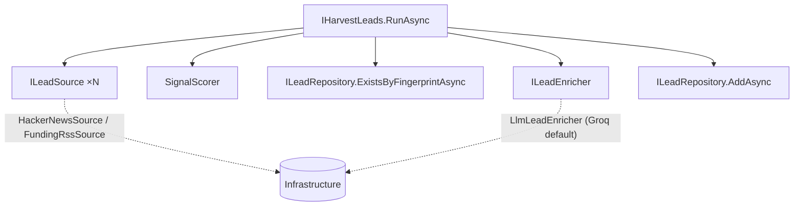

# Coldstart .NET — Lead-Generation Engine (harvest → filter → save)

**Date:** 2026-07-06
**Status:** Proposed
**Author:** Andrzej Lech (with Claude)

## Context

Ports the Python engine's **lead-generation core** to the .NET 10 backend (branch `dotnet-port`, on top of SP1 + the Frontend/Customer-Zone stage). Today the .NET `/app` shows *seeded mock* leads; this stage makes them **real**: harvest public buying signals, filter them, and save qualified leads to Postgres.

Ports these Python parts (reference implementations): `leadengine/pipeline.py` (`run()`), `leadengine/sources/hackernews.py`, `leadengine/sources/funding.py`, `leadengine/signals.py`, `leadengine/enrich.py`, and the niche config `clients/coldstart.yaml`.

**On "removing Python":** this stage retires Python's **harvest + score + enrich**. Full Python removal *also* needs the **email find/verify** port and a **send** path (separate later stages). So after this stage the Python daily harvest can stop, but Python is not deleted until find/verify + send reach parity.

## Goals

1. `.NET` pipeline that mirrors `pipeline.run()`: **harvest → deterministic score gate → dedup → LLM qualify+draft → save**.
2. Two sources ported: **HackerNews** (Algolia HTTP API) and **Funding RSS/Atom** feeds.
3. Deterministic scorer (`signals.py` parity) as the cheap pre-LLM gate.
4. LLM enrichment (qualify-first with disqualifiers → FIT / SUMMARY / SUBJECT / DRAFT / COMPANY), behind a swappable port.
5. Saved leads are real, filtered, and visible in `/app` (attached to a house "Coldstart" customer).
6. Runnable on demand today (console entry) — the same use case a background worker wraps later.

## Non-goals (explicitly later)

Email find/verify; sending/outreach; per-customer/multi-client niches; background scheduling/cron (SP7); job-board sources (Greenhouse/Lever — disabled in the current config).

## Architecture

Hexagonal, in the existing layers. New Application use case `IHarvestLeads` orchestrates the pipeline through ports; Infrastructure supplies the adapters; DI wired in the composition root.

- **Ports (Application):** `ILeadSource { Task<IReadOnlyList<RawItem>> FetchAsync(ct) }`, `ILeadEnricher { Task<EnrichmentResult?> EnrichAsync(RawItem item, NicheOptions niche, SignalResult signal, ct) }`. Reuse existing `ILeadRepository`/`ICustomerRepository`.
- **Adapters (Infrastructure):** `HackerNewsSource` (Algolia HN Search API via `HttpClient`+`System.Text.Json`), `FundingRssSource` (RSS/Atom via `System.Xml.Linq`, funding-term filter like `funding.py`), `LlmLeadEnricher` (Anthropic API by default).
- **Pure logic (Application/Domain):** `SignalScorer` (port of `signals.py`: saturating keyword/signal score, `baseScore` floor, `scoreWeight`); dedup via fingerprint.

## Domain / data changes

The `Lead` aggregate gains provenance (needed for dedup + traceability), all `private set` via an extended factory:
- `Source` (e.g. "hackernews"), `SourceUrl`, `Fingerprint` (stable hash of source+external-id; **unique index**), `Score` (double), `MatchedSignals` (stored as a joined string).
- New `ILeadRepository.ExistsByFingerprintAsync(string fingerprint, ct)`.
- A `RawItem` type (Application/Domain) for harvested-but-not-yet-saved content: `Source, ExternalId, Title, Text, Author, Url, CreatedAt`, with a `Fingerprint` derived from `source:externalId` (matches Python's `RawItem.fingerprint`).
- One EF migration (`AddLeadProvenance`).

## Data flow (mirrors `pipeline.run()`)

1. For each enabled `ILeadSource`: `FetchAsync` → `RawItem`s (source failures are logged and skipped, never abort the run).
2. `SignalScorer.Score(item, niche)` → drop if `< niche.MinScore`.
3. Dedup: skip if `ExistsByFingerprintAsync`.
4. Sort survivors by score desc; take top `niche.MaxEnrichPerRun` (spend cap).
5. `ILeadEnricher.EnrichAsync` → `EnrichmentResult(Fit, Summary, Subject, Draft, Company)`. If the LLM returns nothing (rate limit/error), **skip without saving** (retried next run — Python's behavior).
6. Keep `Fit != No`; build a `Lead` (status `PendingReview`, provenance filled) under the **house Coldstart customer**; `AddAsync`.
7. Return run stats (harvested / scored-in / deduped / enriched / saved).

## Configuration

`NicheOptions` bound from `appsettings`/user-secrets, ported from `coldstart.yaml`:
`Offer, SenderName, SenderTitle, TargetKeywords[], BuyingSignals[], Disqualifiers[], MinScore, MaxEnrichPerRun`, plus `Sources` (HackerNews queries + lookback; Funding feed URLs, lookback, base score, require-funding-terms). **Single niche this stage** (Coldstart's own). `LlmOptions`: `Provider, Model, ApiKey` (key via user-secrets/env, never committed).

## LLM enrichment

`LlmLeadEnricher` implements `ILeadEnricher`; the `enrich.py` prompt (system + qualify-first template with the niche's disqualifiers) is ported and the five labelled lines (`FIT/SUMMARY/SUBJECT/DRAFT/COMPANY`) are parsed. **Default provider: Groq** (`llama-3.3-70b-versatile`, exactly what the Python engine runs on) via its OpenAI-compatible HTTP API — free, proven on this niche, and **no dependency on Anthropic/Claude**. The port stays provider-agnostic so a different enricher can slot in later behind `LlmOptions.Provider`, but that is not built this stage.

## Invocation

A small **console entry** — `src/Coldstart.Harvester` (or a `dotnet run --project src/Coldstart.Web -- harvest` argument) — builds the DI container (`AddApplication` + `AddInfrastructure` + config + secrets) and calls `IHarvestLeads.RunAsync`, printing run stats. Manual/on-demand today; the SP7 `BackgroundService`/cron wraps the *same* use case later. Harvested leads attach to a **house "Coldstart" customer** (resolved by a well-known key, created if missing) so `/app` for that account shows real generated leads.

## Error handling

- Source fetch failure → log + skip that source (run continues).
- LLM failure/empty on an item → skip, don't persist (retried next run).
- Dedup (fingerprint unique index + `ExistsByFingerprintAsync`) prevents doubles across runs.
- No secrets in source/logs; API key from config/secrets.

## Testing

Per standards (xUnit + NSubstitute + FluentAssertions 7.*; strict AAA; Testcontainers Postgres; build 0 warnings).
- **Unit:** `SignalScorer` (parity cases from `signals.py`: 0/1/2/3 hits saturation, base-score floor, weight demotion, below-threshold); enrichment 5-field parser incl. `FIT: NO` → dropped and malformed output; `RawItem.Fingerprint` stability; dedup decision.
- **Integration (Testcontainers, fake `ILeadSource`s + fake `ILeadEnricher`):** run the full pipeline end-to-end → assert only `Fit != No` above-threshold, non-duplicate items persist as `Lead`s with provenance under the house customer; a second run with the same items saves nothing (dedup); a `FIT: NO` item is not saved.
- **Live smoke (network, opt-in/trait-gated):** `HackerNewsSource` + `FundingRssSource` each fetch and parse ≥1 item from the real endpoints. A single real `LlmLeadEnricher` call is a manual/gated check (needs the API key), not part of the default suite.

## Open items / assumptions (confirm before implementation)

- **Scope = full parity (LLM qualify+draft).** (assumed — required for "sellable leads" / retiring Python's generation)
- **LLM provider = Groq** (`llama-3.3-70b-versatile`), matching Python; no Anthropic/Claude dependency. Groq API key via user-secrets/env. Port stays provider-agnostic for a future swap.
- Single niche (Coldstart's own) this stage; multi-client niches later.
- Running live needs the LLM API key in user-secrets; source live-smoke tests need network.
